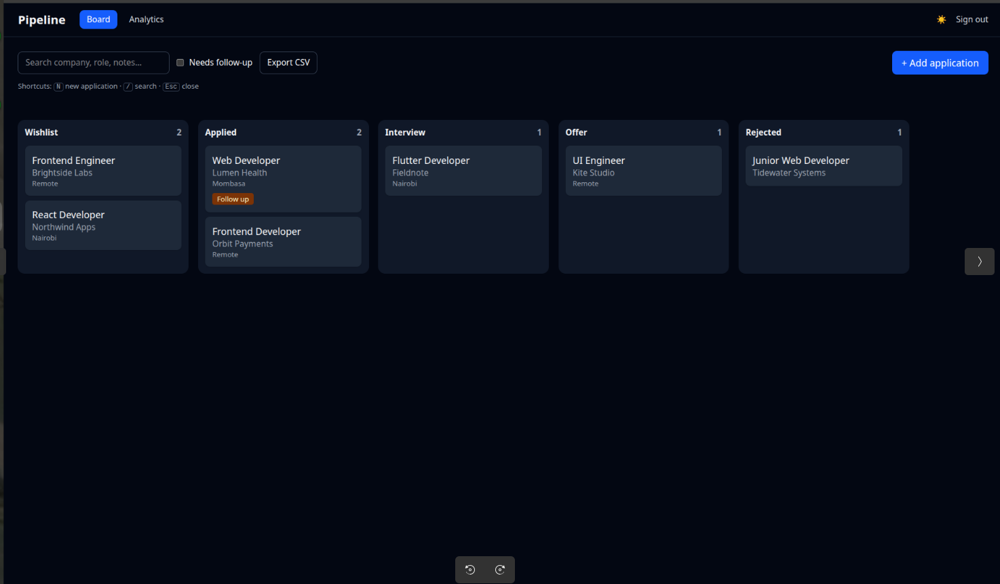
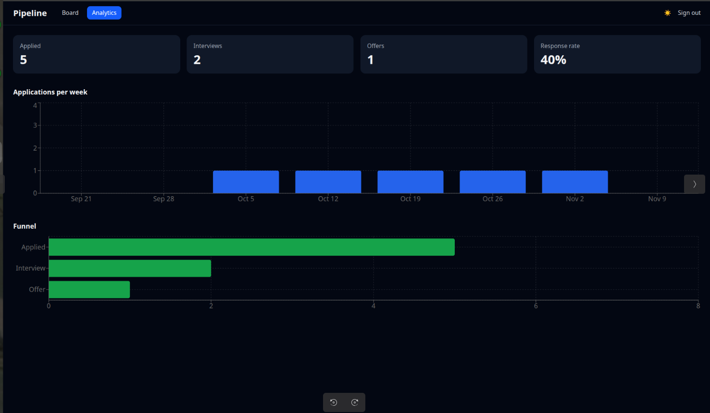

# Pipeline

[](https://github.com/YOUR-USERNAME/pipeline-job-tracker/actions/workflows/ci.yml)

**Track every job application from wishlist to offer, and see where your search is working.**



## Why I built it

I'm finishing my degree and applying for frontend roles. I wanted one place to see every application, what stage it's at, and which ones have gone quiet and need a follow-up. I also wanted to build it the way I'd build a real product: tested, documented and deployed.

## Features

- **Kanban board** with drag and drop between Wishlist, Applied, Interview, Offer and Rejected, plus reordering inside a column
- **Add, edit and delete** applications: company, role, link, location, salary range, notes, follow-up date and the date you applied
- **Status history**: every move between stages is logged with a date and shown on the application
- **Search and filters**, including a "Needs follow-up" view for applications that have gone quiet
- **Analytics**: applications per week, a funnel chart and your response rate, calculated from each application's history
- **Dark mode** (follows your system, with a manual toggle) and a **responsive layout** (press and hold a card to drag on touch screens)
- **Keyboard shortcuts**: `N` new application, `/` search, `Esc` close
- **CSV export**, and a "Load sample data" button so you can look around an empty board
- **Accounts and cloud sync** through Supabase, with Row Level Security so each user only sees their own data



## Tech stack

| Area | Choice |
| --- | --- |
| UI | React, TypeScript, Vite |
| Styling | Tailwind CSS |
| Server state | TanStack Query, with optimistic updates |
| Drag and drop | dnd-kit |
| Charts | Recharts |
| Backend | Supabase: Postgres, Auth, Row Level Security |
| Tests | Vitest and React Testing Library |
| CI | GitHub Actions: lint, test and build on every push |

## How it's built

```
UI components  ->  TanStack Query hooks  ->  ApplicationRepository (interface)
                                               |-- localRepository     (browser localStorage)
                                               `-- supabaseRepository  (Postgres + auth)
```

src/
components/ board, forms, analytics, ui
features/
applications/ types, repository, ordering, history, filters, csv, hooks
analytics/ funnel and weekly-count calculations
auth/ sign-in screen and auth gate
hooks/ useTheme, useHotkeys
pages/ BoardPage, AnalyticsPage
lib/ Supabase client
supabase/ database schema and security policies


### Decisions and trade-offs

- **A repository interface between the UI and storage.** The app started on `localStorage` and moved to Supabase without touching a component. `activeRepository.ts` picks the implementation from environment variables, so the same code runs as a local demo or as a multi-device app.
- **Business logic as pure functions.** Filtering, follow-up detection, funnel counts, weekly counts, CSV generation and the drag-and-drop reordering all take plain data and return plain data, so they are unit-tested without rendering anything.
- **Optimistic updates.** Dragging a card updates the board immediately and rolls back if the save fails.
- **Status history stored on the application.** Each application carries a list of the statuses it has been in. That keeps reads simple and was enough for the funnel. Applications saved before history existed get a fallback entry, so old data still works.
- **Row Level Security instead of a custom API.** The browser talks to Postgres directly with the public key, and database policies make sure users can only read and change their own rows.
- **Native `<dialog>` for the edit form,** so focus trapping and Esc-to-close come from the browser.
- **Spreadsheet formula protection in the CSV export.** Cells starting with `=`, `+`, `-` or `@` are prefixed with a quote so they aren't run as formulas when the file is opened.

## Run it locally

```bash
git clone https://github.com/YOUR-USERNAME/pipeline-job-tracker.git
cd pipeline-job-tracker
npm install
npm run dev
```

With no configuration the app runs in **local mode**: no sign-in, and your data stays in your browser.

### Turn on accounts and cloud sync

1. Create a project at [supabase.com](https://supabase.com).
2. Run `supabase/schema.sql` in the SQL editor.
3. Copy `.env.example` to `.env.local` and fill in your project URL and publishable (anon) key. Never use the secret or `service_role` key.
4. Restart `npm run dev`. You'll now see a sign-in screen.

## Scripts

| Command | What it does |
| --- | --- |
| `npm run dev` | Start the dev server |
| `npm test` | Run the tests in watch mode (`npm test -- --run` for a single run) |
| `npm run lint` | Lint the code |
| `npm run build` | Type-check and build for production |

## Limitations and what I'd do next

- **No end-to-end tests yet.** Unit and component tests cover the logic and forms. A Playwright test of the add, drag and edit flow would be the next addition.
- **Reminders are visual only.** Overdue follow-ups are flagged in the app, but there are no email or push notifications.
- **Drag and drop is pointer-only.** Moving a card by keyboard isn't supported yet. The Status field in the edit form is the accessible alternative.
- **History isn't editable,** and the "applied on" date and the history timestamps are stored separately, so they can differ if you backdate an application.
- **Local data doesn't migrate.** Applications saved in local mode stay in that browser and aren't copied to your account.
PIPELINE_EOF

echo "README written"
